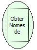

Descrição:

Obtém uma lista com o nome dos parâmetros do fluxo atual.

Parâmetros:

Não possui.

Retorno:

Lista com os nomes dos parâmetros que o fluxo recebe.

Nome Real:

ebfGetInputNames

Compatibilidade:

Servidor
