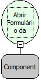

Descrição:

Abre o formulário associado ao componente grade passado como parâmetro.

Parâmetros:

1. Componente Grade.

Retorno:

Não possui

Observações:

1. Para aparecer a lista de componente do formulário é necessário selecionar o formulário de trabalho no "Inicio" do fluxo.

2. Caso não queira selecionar o formulário no início, pode-se escrever o nome (Letras) do componente (nome da grade) como parâmetro.

3. O evento deve estar no mesmo formulário onde está o componente grade.

Nome Real:

ebfOpenFormGrid

Compatibilidade:

Cliente e Servidor
