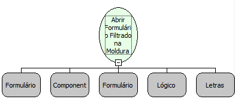

Descrição:

Função que abre um formulário numa moldura filtrado.

Parâmetros:

1. Formulário onde se encontra o componente do tipo moldura;

2. Componente do tipo moldura;

3. Formulário que será aberto na moldura;

4. Valor lógico que indica se a barra de rolagem deverá aparecer.

5. Filtro. Formato: &lt;Tabela 1&gt;.&lt;Campo 1&gt;=&lt;Valor 1&gt;[;&lt;Tabela 2&gt;.&lt;Campo 2&gt;=&lt;Valor 2&gt;[;&lt;Tabela N&gt;.&lt;Campo N&gt;=&lt;Valor N&gt;]]

                       Ex: TAB_PESSOAS.CODIGO=100;TAB_PESSOAS.NOME=José

Observações:

1. Esta função não deve ser utilizada para abrir numa moldura o mesmo Formulário que a contém.

2. Pode-se tipar o valor passando o formato &lt;Valor&gt;@&lt;Tipo&gt;, onde tipo pode ser: long, double, timestamp, date e boolean.

    Ex: TAB_PESSOAS.CODIGO=100@long

          TAB_PESSOAS.NASCIMENTO=10/11/1980@date

3. As modificações feitas no formulário que será aberto na moldura, apenas serão visualizadas quando o sistema é reiniciado.

Nome Real:

ebfFrameOpenFilteredForm

Compatibilidade:

Cliente e Servidor
