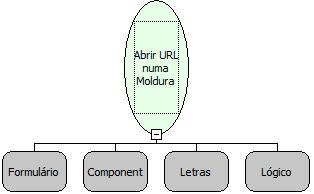

Descrição:

Abre uma url numa moldura.

Parâmetros:

1. Formulário da moldura

2. Nome do componente (moldura)

3. URL

4. Moldura com barra de rolagem?

Observações:

1. Não é suportada a utilização de variáveis de sessão no formulário referenciado no 2º parâmetro desta função.

2. Para colocar um caracter & que esteja entre os dados do valor de um parâmetro de uma URL utilize a combinação: %26 + &

3. A URL deve possuir o protocolo "http://" antes do endereço www, caso contrário, será tratato como uma URL relativa.

Nome Real:

ebfFrameOpenURL

Compatibilidade:

Cliente
