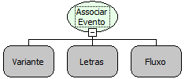

Descrição:

A função executa o fluxo (passado no 3º parâmetro) quando ocorrer o evento (2º parâmetro) no formulário ou componente (1º parâmetro).

Parâmetros:

1. Componente ou formulário

2. Nome do Evento

3. Fluxo a ser executado. (Não é permitido o uso de fluxo que recebem parâmetros)

Retorno:

Não Possui.

Observação:

1. O fluxo de ação a que se refere o 3º parâmetro da função deve ser selecionado pela aba "Fluxos e Funções" da

tela "Propriedades" aberta através da tela "Montador de Expressão" do "Editor de Fluxo de Ações".

2. Não é possível referenciar nesta função o componente "moldura". Para isto, utilize a função "Associar Evento ao Componente".

Exemplo:

Assumindo os parâmetros como "MakerEdit2" (Constante do tipo Componente ou Formulário), "Ao Clicar" (Letras) e "Mensagem de Alerta" (Fluxo a ser executado), quando esta função for executada  a "Mensagem de Alerta" vai ficar associada ao componente (1° parâmetro) no evento "Ao clicar". Assim, toda vez que der um clique no componente "MakerEdit2" a função "Mensagem de alerta" vai ser executada.

Nome Real:

ebfEventAssociate

Compatibilidade:

Cliente
