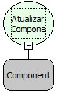

Descrição:

Atualiza o conteúdo do componente passado por parâmetro.

Parâmetros:

1. Componente que será atualizado.

Retorno:

Não Possui.

Observações:

1. Para selecionar o campo é necessário indicar o nome do formulário no de trabalho no "Inicio" do fluxo .

2. Caso não queira selecionar o formulário de trabalho no início do fluxo, digite o nome do componente no lugar do

parâmetro (ao invés de seleciona-lo).

Nome Real:

ebfFormRefreshComponent

Compatibilidade:

Cliente e Servidor
