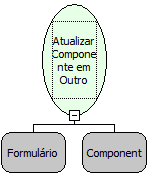

Descrição:

Atualiza o componente em outro formulário.

Parâmetros:

1. Formulário.

2. Componente.

Retorno:

Não possui.

Nome Real:

ebfRefreshComponentOtherForm

Compatibilidade:

Cliente

Observação: Os valores dos componentes só serão alterados se houver algum parentesco entre os formulários.
