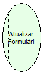

Descrição:

A função atualiza o formulário onde está o evento.

Parâmetros:

Não Possui

Retorno:

Não Possui.

Observação:

1. Se essa função for executada antes de salvar alterações feitas no formulário, estas serão perdidas, pois a

essa função traz os dados existente no banco.

Nome Real:

ebfRefreshForm

Compatibilidade:

Todas as camadas
