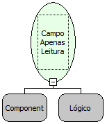

Descrição:

Esta função define um campo do formulário como Apenas Leitura. Caso o parâmetro seja Verdadeiro, define Apenas Leitura. Caso contrário retira esta definição.

Parâmetros:

1. O Componente que se deseja definir como Apenas Leitura.

2. Deseja que o campo se torne Apenas Leitura?

Retorno:

Não possui.

Observações:

1. Esta função permite apenas alterar o campo para apenas leitura. O inverso não é possível.

2. Não é possível definir um campo apenas leitura no Internet Explorer em tempo de execução.

Nome Real:

ebfFormSetReadonly

Compatibilidade:

Todas as camadas
