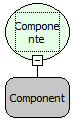

Descrição:

A função retorna true (Verdadeiro) caso o componente passado esteja visível, ou false (falso) caso contrário.

Parâmetros:

1. Componente que deseja obter o valor (Se está visível ou não).

Retorno:

Retorna true (Verdadeiro) caso o componente esteja visível e false (falso) caso contrário.

Observações:

1. Para selecionar o componente é necessário indicar o nome do formulário no de trabalho no "Inicio" do fluxo   .

2. Caso não queira selecionar o formulário de trabalho, digite o nome do componente mudando a constante do tipo

"formulário" para uma constante do tipo "Letras".

Nome Real:

ebfFormGetVisible

Compatibilidade:

Cliente
