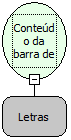

Descrição:

Altera o conteúdo da barra de status

Parâmetros:

1. Conteúdo para a barra de status

Retorno:

Não possui.

Observações:

1. No Browser Firefox é preciso marcar a opção "MODIFICAR TEXTO NA BARRA DE

STATUS" no caminho abaixo:

  I.   FERRAMENTAS

  II.  OPÇÕES

  III. CONTEÚDO

  IV.  BOTÃO AVANÇADO

2. No Browser Internet Explorer verifique se está habilitado o recurso de atualizações da barra de status.

Caminho:

  I. FERRAMENTAS

  II. OPÇÕES

  III.  ABA SEGURANÇA

  IV.  NÍVEL PERSONALIZADO

  V.  "PERMITIR ATUALIZAÇÕES DA BARRA DE STATUS VIA SCRIPT"

Nome Real:

ebfChangeWindowStatusBar

Compatibilidade:

Cliente e Servidor
