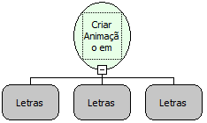

Descrição:

Cria uma Animação em Flash em uma Moldura.

Parâmetros:

1. Aba.

2. Nome da moldura (usada no formulário para exibir a animação).

3. Endereço na internet onde está armazenada a animação. Nome da URL (Localizador Uniforme de Recursos).

Retorno:

Variante.

Exemplo:

Passando como primeiro parâmetro o valor: "Cadastro", o segundo parâmetro o valor "Moldura" e o terceiro parâmetro o endereço "http://www.softwell.com.br/downloads/Baner.swf" (Sem aspas). Deve ser criada a animação em flash na moldura.

Nome Real:

ebfFormCreateFlash

Compatibilidade:

Cliente
