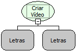

Descrição:

Esta função permite adicionar vídeos a formulários.

Parâmetros:

1. Nome da moldura (usada no formulário para exibir o vídeo).

2. Endereço na Internet onde está armazenado o vídeo.

Retorno:

Variante.

Exemplo:

Nome da URL (Localizador Uniforme de Recursos) http://www.softwell.com.br/downloads/Creed.mpg

Nome Real:

ebfFormCreateVideo

Compatibilidade:

Cliente
