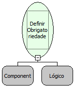

Descrição:

Esta função define se um ou mais componentes são obrigatórios ou não.

Parâmetros:

1. Componente ou lista de componentes.

2. Obrigatório?

Retorno:

Não Possui.

Nome Real:

ebfFormSetRequired

Compatibilidade:

Cliente e Servidor
