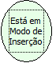

Descrição:

A função obtém o estado do formulário no momento que o fluxo é chamado, retornando true(verdadeiro) caso esteja em modo de inserção ou false(falso) caso contrário.

Parâmetros:

Não Possui.

Retorno:

Retorna true (verdadeiro) caso o formulário esteja em modo de inserção ou false (falso) caso contrário.

Observação:

Não é necessário passar o nome do formulário. O formulário sempre vai ser o que chama o fluxo.

Exemplo:

Assumindo que um formulário está em modo de inserção no momento que o fluxo é chamado. Neste caso, o retorno seria "True".

Nome Real:

ebfFormIsInInsertMode

Compatibilidade:

Cliente e Servidor
