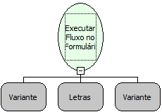

Descrição:

Executa o fluxo de ação definido no segundo parâmetro desta função, observando a referência do formulário retornado pelas funções utilizadas no primeiro parâmetro da função.

Parâmetros:

1. Deve ser utilizada a função "Obter Formulário Chamador" (quando o formulário for aberto através de outro formulário por um botão, dentre outras formas) ou "Obter Formulário Pai" (quando o formulário for aberto em uma moldura no mesmo

formulário);

2. Nome do fluxo de ação que será executado (o nome do fluxo de ação deve ser digitado). O fluxo de ação será executado a partir do formulário (referência do formulário) que foi retornado a partir da função utilizada no primeiro

parâmetro desta função. Só poderá ser utilizado fluxo de ação que tenha como destino a camada Cliente.

3. Deve ser criada uma lista de parâmetros para servirem de parâmetros de entrada para o fluxo de ação que foi informado no segundo parâmetro desta função. Normalmente é utilizada a função "Criar Lista a Partir dos Elementos" para este parâmetro.

Retorno:

Retorno do Fluxo chamado no segundo parâmetro.

Observação:

O retorno desta função será o retorno passado no objeto fim do fluxo executado.

Nome Real:

ebfExecuteRuleOnForm

Compatibilidade:

Cliente
