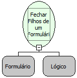

Descrição:

Fecha a árvore de formulários a partir do definido por parâmetro.

Parâmetros:

1. Formulário de onde deve-se partir para fechar todos seus formulários filhos.

2. Define-se se o formulário, definido no Parâmetro 1, deve ser recarregado.

Retorno:

Não possui.

Nome Real:

ebfFormCloseChildren

Compatibilidade:

Cliente e Servidor
