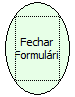

Descrição:

Essa função é utilizada para fechar o formulário que chama o fluxo.

Parâmetros:

Não Possui.

Retorno:

Não Possui.

Exemplo:

Quando essa função for chamada em um formulário, o mesmo será fechado.

Observação:

Não é necessário passar o nome do formulário. O formulário sempre vai ser o que chama o fluxo.

Nome Real:

ebfCloseForm

Compatibilidade:

Todas as camadas
