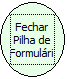

Descrição:

Fecha todos os fomulários que foram utilizados para abrir o formulário atual.

Parâmetros:

Não possui.

Retorno:

Não possui.

Observação:

Não fecha o formulário principal.

Nome Real:

ebfCloseMasterForm

Compatibilidade:

Cliente e Servidor
