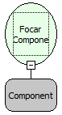

Descrição:

Essa função é utilizada para focar um determinado componente  passado como parâmetro.

Parâmetros:

1. Componente que vai ter o foco.

Retorno:

Não Possui.

Observação:

1. Para selecionar o componente é necessário indicar o nome do formulário no de trabalho no "Inicio" do fluxo   .

2. Caso não queira selecionar o formulário de trabalho, digite o nome do componente mudando a constante do tipo "formulário" para uma constante do tipo "Letras"

Exemplo:

Assumindo como parâmetro o componente "Cidade"  (MakerEdit1), após essa função ser executada, o foco do cursor estará neste componente passado como parâmetro.

Nome real:

ebfFormSetFocus

Compatibilidade:

Cliente e Servidor
