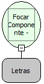

Descrição:

Muda o foco do componente para o próximo componente de acordo com a tabulação.

Parâmetro:

1. ID do Componente em foco.

Retorno:

Não Possui.

Observação:

Pode ser utilizado o nome do componente ou obter através da função "Obter ID do Componente".

Nome Real:

ebfNextFocus

Compatibilidade:

Cliente
