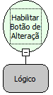

Descrição:

Habilitar Botão de Alteração

Parâmetros:

1. Lógico (Verdadeiro para Habilitar, Falso para Desabilitar)

Retorno:

Não possui.

Nome Real:

ebfEnableEditButton

Compatibilidade:

Cliente
