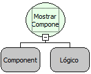

Descrição:

Esta função mostra o componente se a condição passada no segundo parâmetro for verdadeira, ou oculta caso a condição seja falsa.

Parâmetros:

1. Componente que ficará visível ou oculto.

2. Condição para mostrar o componente

Retorno:

Não Possui.

Observações:

1. Para selecionar o componente é necessário indicar o nome do formulário de trabalho no "Inicio" do fluxo   .

2. Caso não queira selecionar o formulário de trabalho, digite o nome do componente mudando a constante do tipo "Componente"

para uma constante do tipo "Letras".

Exemplos:

1. Assumindo como parâmetros o componente "Cidade"  (MakerEdit1),  e uma condição lógica "Ano Atual= 2000", quando a função for executada, caso o Ano atual seja 2000 o componente "MakerEdit1" ficará visível, Caso seja diferente de 2000 o campo ficará oculto.

2. Assumindo como parâmetros o componente "Cidade"  (MakerEdit1),  e uma condição lógica  false, quando a função for executada o componente ficará oculto.

Nome Real:

ebfFormSetVisible

Compatibilidade:

Servidor e Cliente
