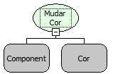

Descrição:

Esta função altera a cor do conteúdo do componente.

Parâmetros:

1. Componente cujo conteúdo mudará de cor.

2. Nova cor do conteúdo do componente.

Retorno:

Não Possui.

Exemplo:

Assumindo como parâmetros o componente "Cidade"  (MakerEdit1), e a cor Azul, quando o fluxo for executado o conteúdo do componente "MakerEdit1" passará a ser  azul.

Observações:

1. Para selecionar o componente é necessário indicar o nome do formulário de trabalho no "Inicio" do fluxo   .

2. Caso não queira selecionar o formulário de trabalho, digite o nome do componente mudando a constante do tipo "formulário" para uma constante do tipo "Letras".

Nome Real:

ebfFormSetColor

Compatibilidade:

Cliente e Servidor
