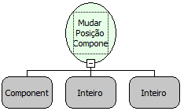

Descrição:

Esta função altera a posição do componente passado como parâmetro.

Parâmetros:

1. Componente que mudará de posição.

2. Nova posição X (Horizontal) do componente.

3. Nova posição Y (Vertical) do componente.

Retorno:

Não Possui.

Exemplo:

Assumindo como parâmetros o componente "Cidade"  (MakerEdit1), o valor 150 (Inteiro) e o valor 250 (Inteiro), quando o fluxo for executado a  posição X do componente será 150 e a Y será 250.

Observações:

1. Para selecionar o componente é necessário indicar o nome do formulário de trabalho no "Inicio" do fluxo   .

2. Caso não queira selecionar o formulário de trabalho, digite o nome do componente mudando a constante do tipo "formulário" para uma constante do tipo "Letras"

Nome Real:

ebfFormSetPosition

Compatibilidade:

Cliente e Servidor
