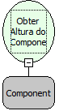

Descrição:

Obtém a altura (em pixels) do componente passado como parâmetro.

Parâmetros:

1. Nome do Componente.

Retorno:

Altura do componente. (Inteiro)

Nome Real:

ebfFormGetHeight

Compatibilidade:

Cliente
