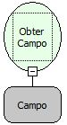

Descrição:

Obtém o conteúdo do campo passado como parâmetro.

Parâmetros:

1. Campo no qual deseja obter o conteúdo.

Retorno:

Conteúdo do campo.

Observações:

1. Para selecionar o campo é necessário indicar o nome do formulário no de trabalho no "Inicio" do fluxo.

2. Caso não queira selecionar o formulário de trabalho, digite o nome do campo mudando a constante do tipo "formulário" para uma constante do tipo "Letras".

3. É necessário que o componente esteja associado a um campo da tabela.

4. Caso o formulário que se deseja obter o campo esteja dentro de um componente moldura, deve-se utilizar a função "Executar Fluxo no Formulário" e apontar para um fluxo que contenha esta função.

Exemplo:

Em um formulário cujo conteúdo do campo "Cidade" é "Salvador", assumindo como parâmetros este campo ("Cidade") , o retorno seria "Salvador".

Nome Real:

ebfSQLGetFormField

Compatibilidade:

Cliente e Servidor
