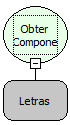

Descrição:

Obtém o  componente passado como parâmetro (Objeto).

Parâmetros:

1. Função do tipo letras.

Retorno:

Retorna a referência do componente.

Observações:

1. Se o formulário não for o principal (o que chama o fluxo), essa função não vai funcionar em regras do tipo cliente;

2. Se não for o formulário principal (que chama o fluxo) e o mesmo estiver aberto, o retorno será o conteúdo do campo passado naquele registro. Caso o formulário passado não esteja sendo utilizado, o retorno será o primeiro registro no banco.

Exemplo:

Assumindo como componente "MakerEdit2", o retorno será o objeto deste componente.

Nome Real:

ebfFormComponentByName

Compatibilidade:

Cliente
