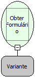

Descrição:

Obtém a referência do formulário a partir do qual um outro formulário foi aberto; normalmente abertos através de botões, dentre outros.

Parâmetros:

1. Utilize a função Obter Formulário Atual

Retorno:

Referência do Formulário a partir do qual um formulário foi aberto.

Nome Real:

ebfGetOpenerForm

Compatibilidade:

Cliente
