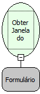

Descrição:

Obtém a janela (instância) do formulário definido no parâmetro.

Parâmetros:

1. Letras (GUID do Formulário)

Retorno:

Referência do Formulário. (Variante).

Nome Real:

ebfGetFormByGuid

Compatibilidade:

Cliente
