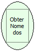

Descrição:

Esta função retorna uma lista com o nome de todos os componentes presentes na tela onde esta função foi chamada.

Parâmetros:

Não Possui.

Retorno:

Lista com Nome dos Componentes (Variante)

Nome Real:

getAllComponentNames

Compatibilidade:

Cliente
