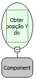

Descrição:

Obtém e retorna a posição vertical (Y) do componente passado como parâmetro.

Parâmetros:

1. Componente que se deseja obter a posição vertical(Y).

Retorno:

Retorna a posição vertical (Inteiro) do componente passado como parâmetro.

Exemplo:

Em um formulário com um componente "Cidade" cuja posição vertical é 250, assumindo como parâmetros este componente ("Cidade") ,o retorno seria 250(Inteiro).

Observações:

1. Para selecionar o componente é necessário indicar o nome do formulário de trabalho no "Inicio" do fluxo .

2. Caso não queira selecionar o formulário de trabalho, digite o nome do componente mudando a constante do tipo "formulário" para uma constante do tipo "Letras".

Nome Real:

ebfGetComponenteYPosition

Compatibilidade:

Cliente
