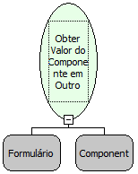

Descrição:

Função que obtém o valor do componente desejado em qualquer formulário aberto.

Parâmetros:

1. Formulário onde se encontar o componente;

2. Componente desejado;

Retorno:

Não possui.

Observações:

1. Para obter o valor de um componente que se encontra em um Sub Form, deve ser passado o formulário do Sub Form como parâmetro.

2. Quando o formulário se encontra dentro de um componente moldura, deve-se utilizar a função "Executar Fluxo no Formulário"apontando para um fluxo que obtem o valor do componente.

Nome Real:

ebfGetComponentValueFromOtherForm

Compatibilidade:

Cliente
