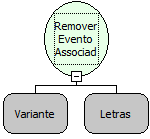

Descrição:

Essa função recebe como parâmetro uma constante do tipo Componente ou Formulário, o nome do evento e retira o evento anteriormente associado. A função que associa um evento ao componente é  "Associar Evento" da categoria "Formulário".

Parâmetros:

1. Constante do tipo Componente ou Formulário.

2. Onclick(Ao Clicar) - Nome do Evento

Retorno:

Não Possui

Nome Real:

ebfEventRemoveAssociation

Compatibilidade:

Cliente
