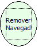

Descrição:

Remove o navegador do formulário que chama o fluxo.

Parâmetros:

1. Não Possui.

Retorno:

Não Possui.

Exemplo:

Em um formulário que possua barra de navegação, quando essa função for executada esta barra será removida.

Observação:

Navegador que vai ser removido será a do formulário que chama o fluxo.

Nome Real:

removeNavigator

Compatibilidade:

Cliente
