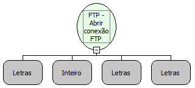

Descrição:

Abre uma conexão com um servidor via FTP.

Parâmetros:

1. Host

2. Porta

3. Usuário

4. Senha

Retorno:

Referência da Conexão (Variante)

Exemplo:

 1º parâmetro: ftp.google.com

 2º parâmetro: 21

 3º parâmetro: anonymous

 4º parâmetro: password

 Retorno: Conexão FTP

Nome Real:

ebfFTPConnect

Compatibilidade:

Servidor
