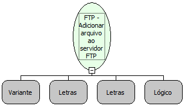

Descrição:

Adiciona um arquivo ao servidor FTP.

Parâmetros:

1. Conexão FTP

2. Arquivo de origem

3. Destino no servidor

4. Transferência binária?

Retorno:

Não possui

Exemplo:

1º parâmetro: conexao FTP ( retorno da função "Abrir conexão FTP" )

2º parâmetro: c:/tpArquivoOrigem.txt

3º parâmetro: /pastadestino/ArquivoDestino.txt

4º parâmetro: Verdadeiro (Valor Lógico)

Nome Real:

ebfFTPPut

Compatibilidade:

Servidor
