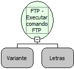

Descrição:

Executa um Comando FTP passado como parâmetro.

Parâmetros:

1. Um Objeto FTP (Variante) que represente uma conexão FTP aberta.

2. Comando a ser executado.

Retorno:

Não possui.

Nome Real:

ebfFTPSendServer

Compatibilidade:

Servidor
