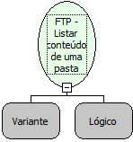

Descrição:

Essa função vai listar o conteúdo de uma pasta. Caso o valor informado no segundo  parâmetro tenha um valor lógico verdadeiro, será listado arquivos, pastas e outras informações dos mesmo, se o valor for falso será exibido apenas uma lista contendo os arquivos e pastas do diretório.

Parâmetros:

1. Um Objeto FTP (Variante) que represente uma conexão FTP aberta.

2. Um valor lógico, esse valor será o responsavel pelo tipo de retorno dessa função, se verdade, o retorno será mais detalhado, caso contrário, só será listado as pastas e arquivos contidas nesse diretório.

Retorno:

Lista contendo arquivos e pastas dentro do diretório informado (Letras)

Nome Real:

ebfFTPListFile

Compatibilidade:

Servidor
