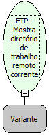

Descrição:

Mostrar qual é o diretório de trabalho remoto corrente.

Parâmetros:

1. Um Objeto FTP (Variante) que represente uma conexão FTP aberta.

Retorno:

Nome do diretório (Letras)

Nome Real:

ebfFTPGetFolder

Compatibilidade:

Servidor
