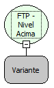

Descrição:

Muda o diretório de trabalho para o diretório "pai" (superior) do diretório atual.

Parâmetros:

1. Objeto FTP (Variante) que represente uma conexão FTP aberta.

Retorno:

Não possui.

Nome Real:

ebfFTPFolderUp

Compatibilidade:

Servidor
