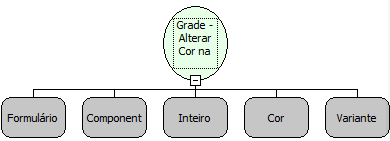

Descrição:

Altera a cor de uma linha da grade ou apenas algumas colunas da grade.

Parâmetros:

1. Formulário que contém a grade

2. Componente grade que se deseja pintar

3. Linha que deve ser alterada (primeira linha é 0)

4. Cor desejada

5. Lista contendo as colunas que devem ser pintadas (primeira coluna é 0)

Retorno:

Não possui

Observação:

Caso o parâmetro 5 seja definido como Nulo, então toda a linha será pintada.

Nome real:

ebfGridSetColor

Compatibilidade:

Cliente e Servidor
