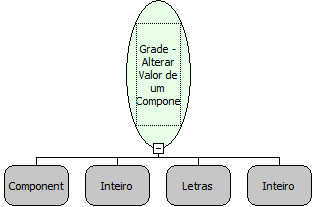

# Grade - Alterar Valor de um Componente CheckBox

Descrição:

Altera o valor do CheckBox na grade.

Parâmetros:

1. Nome da Grade

2. Número da Linha

3. Nome da Coluna que se encontra o componente CheckBox

4. Valor inteiro (0- Desmarcar, 1- Marcar,  2- Nulo).

Retorno:

Não Possui

Observação:

Não possui interação com o banco de dados, ou seja, só modifica o valor na grade, porem o conteúdo no banco continua sendo o mesmo.

Nome Real:

ebfGridSetCheckValue

Compatibilidade:

Cliente e Servidor
