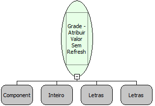

Descrição:

Essa função atribui um valor na Grade, informando o nome da grade, a linha, nome da coluna e o valor que deseja atribuir a respectiva linha e coluna sem atualizar a grade.

Parâmetros:

1. Nome da Grade

2. Número da Linha (De 0 à N-1)

3. Nome da Coluna

4. Valor a ser atribuído

Retorno:

Não possui.

Exemplo:

Assumindo o 1º parâmetro sendo Grade Salário, o 2 º parâmetro sendo 2, o 3º parâmetro sendo Nomes e o 4º parâmetro sendo 500. Passando esses parâmetros, será adicionado à Grade Salário o valor de 500 na terceira linha da coluna Nomes.

Observação:

Os dados atribuídos a coluna na grade apenas serão visualizados se for utilizada a função "Grade - Dar Refresh" posteriormente.

Nome Real:

ebfGridSetValueNoRefresh

Compatibilidade:

Cliente
