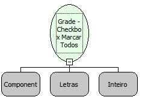

Descrição:

Altera o valor de todos os  CheckBoxes de uma coluna da grade.

Parâmetros:

1. Nome da Grade

2. Nome da Coluna que se encontra o componente CheckBox

3. Valor inteiro (0 - Desmarcar, 1- Marcar, 2 - Neutro).

Retorno

Não Possui

Nome Real:

ebfGridSetAllCheckValue

Compatibilidade:

Cliente e Servidor
