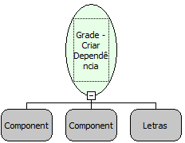

Descrição:

Cria relação de dependência entre duas grids.

Parâmetros:

1. Grade Pai (Mestre)

2. Grade Filha

3. Filtro de ligação no formato: &lt;Tabela da Grid Filha&gt;.&lt;Campo 1 da Grid Filha&gt;=&lt;Campo da Grid Master&gt;[;&lt;Tabela da Grid Filha&gt;.&lt;Campo 2 da Grid Filha&gt;=&lt;Campo da Grid Master&gt;[;&lt;Tabela da Grid Filha&gt;.&lt;Campo N da Grid Filha&gt;=&lt;Campo da Grid Master&gt;]].

Exemplo:

1. TB_FILHA.CAMPO_FILHA=CAMPO_MASTER

2. TB_CIDADE.COD_PAIS=COD_PAIS

3. TB_CIDADE.COD_PAIS=COD_PAIS;TB_CIDADE.COD_CIDADE=COD_CIDADE

Nome Real:

ebfGridCreateDependence

Compatibilidade:

Cliente
