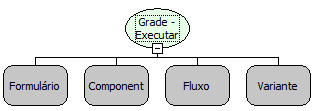

Descrição

Executa um fluxo ao utilizar a navegação do componente Grade.

Parâmetros:

1. Formulário onde se encontra a grade;

2. Componente grade que a função será associada;

3. Fluxo que será associado à grade;

4. Lista de parâmetros do fluxo (parâmetro 3).

Retorno:

Não possui.

Nome Real:

ebfGrigExecuteFlowOnPage

Compatibilidade:

Cliente e Servidor.
