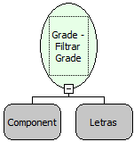

Descrição:

Filtra um componente grade de acordo com a condição passada.

Parâmetros:

1. Grid a ser filtrada

2. Filtro de ligação no formato: &lt;Tabela da Grid&gt;.&lt;Campo 1 da Grid&gt;=&lt;Valor&gt;[;&lt;Tabela da Grid&gt;.&lt;Campo 2 da Grid &gt;=&lt;valor&gt;[;&lt;Tabela da Grid&gt;.&lt;Campo N da Grid&gt;=&lt;valor&gt;]].

Exemplo:

1. TB_FILHA.CAMPO_FILHA=Teste

2. TB_CIDADE.COD_PAIS=55

3. TB_CIDADE.COD_PAIS=55;TB_CIDADE.COD_CIDADE=856

Observação:

1. O único operador que pode ser utilizado como filtro é o operador "=" (igual).

2. Para utilizar tipos específicos de dados como data, o valor deve ser concatenado com algumas constantes. Os tipos possíveis são: long, double, boolean, date, timestamp.

Exemplo de uso:

TABELA.CAMPO = 05/12/2009@date

Nome Real:

ebfGridFilter

Compatibilidade:

Cliente
