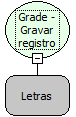

Descrição:

Grava o registro que estiver sendo inserido ou alterado.

Parâmetros:

1. Nome da grade

Retorno:

Não possui.

Observação:

A grade precisa ser editável e estar no modo de inserção ou edição no momento em que a função for chamada.

Nome Real:

ebfGridEditablePost

Compatibilidade:

Cliente
