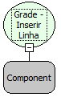

Descrição:

Essa função acrescenta uma linha na grade.

Parâmetros:

1. Nome da Grade

Exemplo:

Assumindo o 1º parâmetro sendo "Grade Vendas". Passando esse parâmetro, será inserida uma linha na Grade "Grade Vendas".

Nome Real:

ebfGridInsertRow

Compatibilidade:

Cliente
